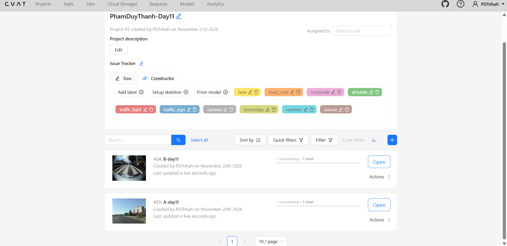
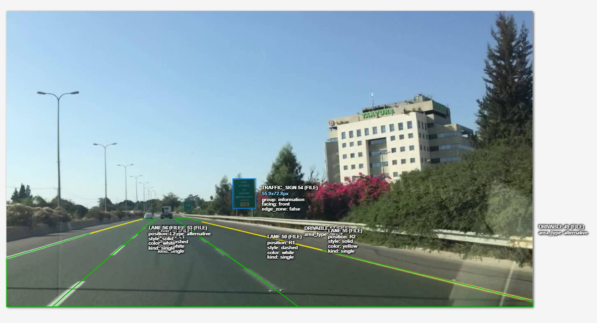
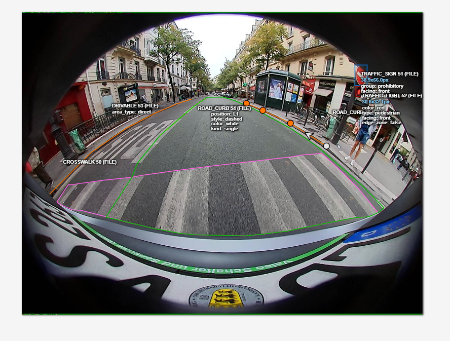
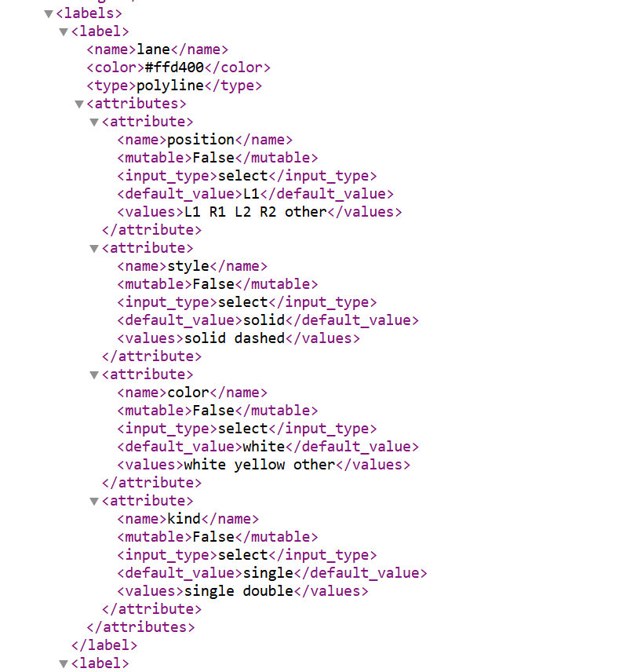

# Báo cáo cá nhân — Ngày 11
Họ tên: Phạm Duy Thanh              Mã học viên:  2A202603343
Phiên bản CVAT (Help → About):  2.74.0
Guideline: Road v1.0    Lần nộp (`revision` trong manifest):  1
Thời điểm export (ngày giờ trên CVAT): 10:00 21/11/2026   Số lần nộp lại sau Rework:  0

## 1. Kiểm project
| Mục | Đúng như guideline Road v1.0? | Ghi chú |
| --- | --- | --- |
| 6 label, đúng kiểu | Đúng | lane, road_curb: polyline; crosswalk, drivable: polygon; traffic_light, traffic_sign: rectangle |
| Thuộc tính và giá trị | Đúng | lane: position (L1/R1/L2/R2/other), style (solid/dashed), color (white/yellow/other), kind (single/double). drivable: area_type (direct/alternative). traffic_light: color, type, facing, edge_zone. traffic_sign: group, facing, edge_zone. Mặc định của CVAT là giá trị đầu danh sách (L1/solid/white/single, direct, red/vehicle/front, prohibitory/front) nên phải sửa lại trong Details |
| 4 tag ảnh | Đúng | camera (front, fisheye_front, fisheye_rear, fisheye_left, fisheye_right), timeofday (day, dusk, night), weather (clear, overcast, rain, fog, other), source (real, simulated). Mỗi tag là label kiểu Tag |
Cách kết thúc polyline trên bản CVAT này:  Click các điểm từ gần xe (đáy ảnh) ra xa, rồi bấm phím N để kết thúc polyline.
Cách đặt tag ảnh trên bản CVAT này:  Mỗi tag ảnh là một label kiểu Tag có một thuộc tính select tên `value` (ví dụ label `camera`, `value` = `fisheye_left`). Không dùng một label riêng cho mỗi giá trị. Đặt camera trước, rồi timeofday, weather, source, mở Details kiểm lại giá trị vì CVAT tự điền giá trị đầu danh sách. Export ra XML dạng `<tag label="camera"><attribute name="value">…</attribute></tag>`.

## 2. Số lượng đã gán
| Task | Ảnh | lane | road_curb | crosswalk | drivable | traffic_light | traffic_sign |
| --- | ---: | ---: | ---: | ---: | ---: | ---: | ---: |
| front | 12 | 34 | 9 | 4 | 25 | 22 | 17 |
| front-extra (đã làm 0 / 4) | 0 | 0 | 0 | 0 | 0 | 0 | 0 |
| fisheye | 8 | 8 | 7 | 7 | 9 | 5 | 3 |
| fisheye-extra (đã làm 0 / 4) | 0 | 0 | 0 | 0 | 0 | 0 | 0 |

Số liệu lấy từ `shapes_by_label` trong PhamDuyThanh-manifest.json (revision 1).

## 3. Bảng ca khó
| Ảnh | Nhãn | Phân vân giữa | Đã chọn | Lý do |
| --- | --- | --- | --- | --- |
| A10 | weather (tag ảnh) | overcast / rain | overcast | Mặt đường ướt và phản chiếu đèn, nhưng không thấy vệt mưa trên kính nên không đủ căn cứ để gán rain |
| A06 | traffic_sign "ONE WAY" (group) | supplementary / mandatory | supplementary | Giữ supplementary theo lựa chọn ban đầu |
| A03 | vạch kẻ vàng chéo bên trái xe | gán lane / không gán | không gán | Không gán vì không phải đối tượng lane cần gán theo guideline |

## 4. Phiếu QC 1 nhận được
Bạn kiểm lô của tôi:  Trần Trọng Thái   Quyết định nhận được:  Release (0 lỗi nặng, 10 lỗi chính / 230 nhãn = 4,3 %, dưới ngưỡng 5 %; 4 ca chờ lead)
| Mã lỗi | Số lỗi | Đồng ý? | Đã sửa? |
| --- | ---: | --- | --- |
| QC1-07 (A11, drivable direct khuyết góc quanh xe SUV) | 1 |  |  |
| QC1-09 (A03, traffic_sign group information → phải là warning) | 1 |  |  |
| QC1-11 (B03 lane#4, B06 lane#0: chỉ 3 điểm trên fisheye) | 2 |  |  |
| QC1-11 (B02 traffic_light#0,#1,#3; B03 sign#1; B04 sign#3; B05 sign#4: thiếu edge_zone) | 6 |  |  |
| Tổng | 10 |  |  |

## 5. Kiểm file export
| File | Mở lại được? | Số shape ảnh 1 (job / file) | Số shape ảnh 2 (job / file) | Tag camera có trong XML? |
| --- | --- | --- | --- | --- |
| PhamDuyThanh-front.zip (48 628 B, 12 ảnh) |  |  |  | Có: images_all_tags = 12/12 |
| PhamDuyThanh-fisheye.zip (26 066 B, 8 ảnh) |  |  |  | Có: images_all_tags = 8/8 |

Manifest: contains_images = false, images_unlabelled = 0 ở cả hai file. Lint road_check: 5 nặng, 9 chính, 5 nhẹ.

## 6. Ảnh chụp màn hình
1. Tab Labels của project.

2. Một ảnh camera trước đã gán đủ (làn, vùng lái, đèn/biển).

3. Một ảnh fisheye đã gán, phóng to đoạn polyline cong.

4. Một đoạn XML có <polyline label="lane">.

## 7. Tự đánh giá
Lỗi bạn mắc nhiều nhất hôm nay (theo mã QC1-xx), và cách tránh ở Ngày 20:  QC1-11 (fisheye), 8/10 lỗi. Gồm 2 polyline lane chỉ 3 điểm và 6 box traffic_light/traffic_sign quên bật edge_zone. Cách tránh: trên fisheye đặt điểm theo cung (thêm điểm ở đoạn cong), và trước khi export lọc mọi box có tâm ngoài 80 % bán kính vòng ảnh để kiểm edge_zone.
Nhãn của bạn đi vào model ở đâu? Chọn một lỗi đã sửa và nói nó làm model học sai thế nào:  Nhãn đi vào bước huấn luyện model nhận diện làn (row-anchor) và detector đèn/biển. Lỗi lane chỉ 3 điểm trên fisheye (B03 lane#4): đoạn cong bị nối thẳng, nên x tại các hàng anchor lệch khỏi vạch thật. Model học vị trí làn sai ở rìa ảnh, và LKA có thể đánh lái sai ở khúc cua. Lỗi thiếu edge_zone khiến box ở vùng méo bị coi như box bình thường, nên model bị phạt khi lỗi định vị ở vùng méo và học lẫn hai kiểu.

## 8. (Tùy chọn, buffer) Từ polyline đến đích row-anchor
| y | 720 | 680 | 640 | 600 | 560 |
| --- | ---: | ---: | ---: | ---: | ---: |
| x của chúng tôi |  |  |  |  |  |
| x của bạn kia |  |  |  |  |  |

Trả lời 3 câu:

1. Năm số x đó chính là đích mà một model row-anchor học cho vạch này. Nếu bạn dừng polyline sớm 40 px, hàng nào đổi thành "không có làn"?
2. So với bạn được kiểm (cùng ảnh): ở hàng 720 và hàng 560, hai bạn lệch nhau bao nhiêu pixel? Lệch ở hàng nào ảnh hưởng LKA nhiều hơn (slide 25)?
3. Nếu polyline vẽ từ xa về gần (ngược quy tắc 2), cách tính trên có đổi không? Script nào sẽ gặp khó?
